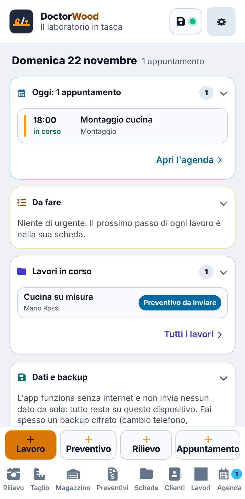
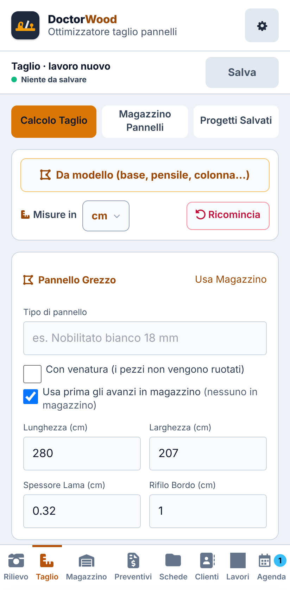
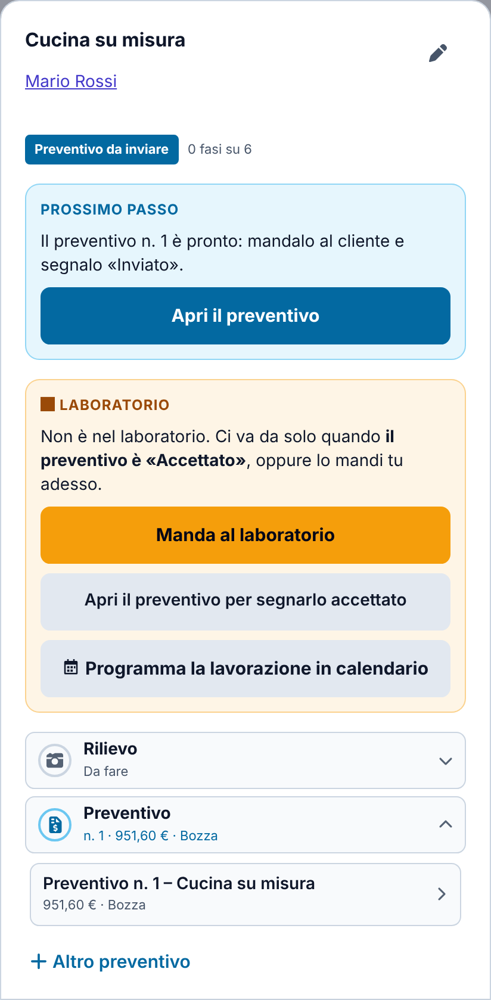
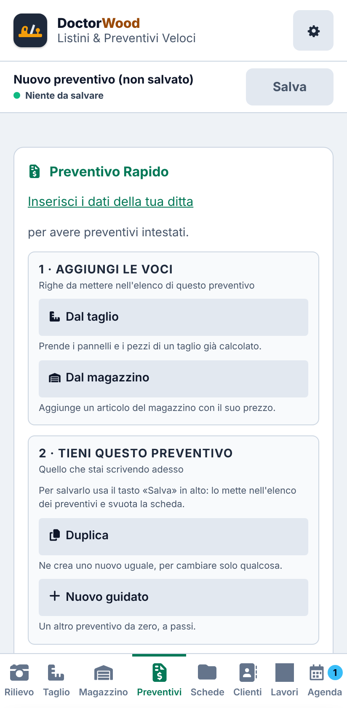
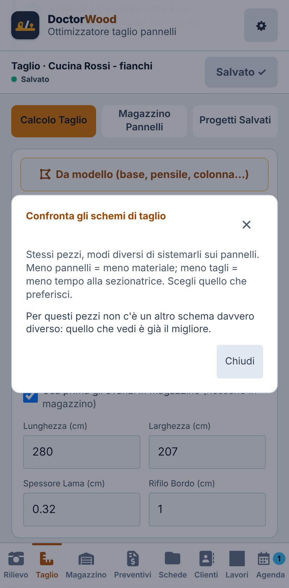
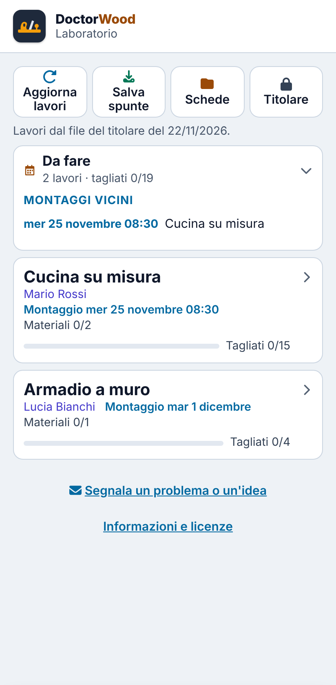

<p align="center">
  
</p>

<h1 align="center">DoctorWood</h1>
<p align="center"><b>Il gestionale per la falegnameria, anche senza internet.</b></p>

<p align="center">Android 10+ · v1.1.0 · Anche su PC · Gratis e open source (GPL-3.0)</p>

---

## Installare

1. Apri la pagina **[Releases](../../releases/latest)** di questo repository dal telefono o dal tablet.
2. Scarica il file `DoctorWood-….apk` e aprilo. La prima volta Android chiede di permettere l'installazione dal browser o dall'app File.
3. Fatto. Le versioni successive arrivano da sole: DoctorWood controlla una volta a settimana se ce n'è una nuova (si può spegnere in Impostazioni → Aggiornamenti) e Android chiede sempre la conferma. Vale anche per il tablet del laboratorio.

Si installa sopra la versione precedente senza perdere i dati. Serve **Android 10 o più recente**.

## Cos'è

DoctorWood riunisce gli strumenti di tutti i giorni di un falegname: dal **rilievo in cantiere** al **taglio dei pannelli**, dal **preventivo** al **montaggio**. Funziona **offline**: i dati restano sul tuo dispositivo, senza account e senza cloud.

Esiste in due forme dello stesso codice: una **pagina web** in un solo file da aprire dal PC, e un'**app Android** con fotocamera, impronta e sincronizzazione fra il telefono del titolare e il tablet di bottega.

<p align="center">
  
  &nbsp;
  
  &nbsp;
  
</p>

## Funzioni

### Clienti e lavori
- **Clienti** con telefono, email, indirizzo, P.IVA o codice fiscale.
- **Lavori**: tutto di una commessa in un posto (rilievo, preventivo, taglio, materiali, appuntamenti, montaggio, pagamento, note), con il **prossimo passo** sempre in vista.
- **Percorsi guidati** per il nuovo lavoro e il nuovo preventivo.
- **Agenda** a settimana o a mese; i giorni di **lavorazione** si mettono in calendario tutti insieme dal lavoro.

### In cantiere
- **Rilievi** con le **foto** e le quote disegnate sopra, scattate con una fotocamera dedicata (zoom, grandangolo, HDR, griglia, livella) e **PDF del rilievo**.

### Progettare e vendere
- **Taglio pannelli**: ottimizza i pezzi sui pannelli, parte anche **da un modello** (base, pensile, colonna…), recupera gli avanzi e **confronta fino a quattro schemi** (pannelli, scarto, tagli). Distinta e **etichette** in PDF (con codice a barre e **QR**), tabella per la sezionatrice, **DXF**.
- **Preventivi** in PDF con le voci dal taglio e dal magazzino, **foto del sopralluogo**, **firma del cliente** con il dito (valida solo se il preventivo non cambia dopo) e **«Per la fattura»** (un CSV per il commercialista).
- **Magazzino**: listino, scorte, «Da riordinare», ricarichi.

<p align="center">
  
  &nbsp;
  
  &nbsp;
  
</p>

### Il tablet di bottega
- **Modalità Laboratorio**: schermo intero, scritte grandi, app fissata sullo schermo; solo i lavori da produrre, i pezzi da tagliare, i materiali e le schede di montaggio. **Niente prezzi.**
- **Tablet «solo laboratorio»**: scelto al primo avvio, resta per sempre in Laboratorio, senza PIN. Sul tablet arrivano solo titolo del lavoro, nome del cliente, indirizzo e data del montaggio, pezzi e materiali: mai prezzi, telefoni, email o partite IVA (una prova automatica lo controlla).
- **Spunte** dei pezzi tagliati e dei materiali presi, che tornano al titolare; **«Leggi etichetta»** con il QR.
- **Schede di montaggio** con foto e PDF.

### Telefono del titolare e tablet, sempre allineati
- **Sincronizzazione diretta nella stessa Wi‑Fi** con PairWood: i lavori passano dal telefono al tablet senza internet e senza server, in TLS 1.3.
- **Abbinamento con QR**; «Dispositivi abbinati», «Dimentica», «Cambia codice» per un tablet perso.
- I lavori sono **firmati dal titolare**: il tablet scarta tutto ciò che non è firmato da quella chiave.
- In alternativa, sincronizzazione **tramite una cartella** gestita da un'app esterna (Syncthing, Drive…): solo file cifrati.

### Sicurezza
- **Cassaforte**: su un dispositivo usato da Titolare, passando in Laboratorio i dati si cifrano con una chiave protetta dall'impronta e, per emergenza, da una password.
- **Blocco con impronta o PIN** all'apertura e al ritorno nell'app; niente contenuto nelle app recenti.
- **Backup solo cifrati** (AES‑256‑GCM, PBKDF2‑SHA‑256 a 600.000 giri) con controllo della robustezza della password.
- **«Cancella tutto da questo dispositivo»** elimina dati, chiavi e permessi.

### Aspetto e aiuto
Tema automatico, chiaro o scuro (cambia in un colpo, senza sfarfallio), tre dimensioni del testo, animazioni e vibrazione regolabili, fluidità dello schermo fino a 120 Hz. **Segnala un problema o un'idea** prepara una mail a crslabs.info@gmail.com che spedisci tu.

## Sicurezza e privacy
- La pagina **non può collegarsi a internet**: regola CSP `connect-src 'none'`, solo script con impronta sha256, nessuna libreria esterna.
- La rete la usano solo il codice nativo di PairWood (verso i dispositivi abbinati) e il controllo degli aggiornamenti (una lettura da GitHub a settimana, si può spegnere). Nessun dato tuo esce dal dispositivo. Dettagli in [`PRIVACY.md`](PRIVACY.md).
- Gli aggiornamenti si installano solo se l'APK ha la stessa firma dell'app e la stessa impronta SHA-256 pubblicata.
- Ogni dato in entrata (backup, sincronizzazione, file) viene ripulito campo per campo; ogni dato mostrato passa da `esc()`.

## Documentazione
| Cosa | Dove |
|---|---|
| Guida all'uso con immagini (PDF) | [`guida/DoctorWood-Guida.pdf`](guida/DoctorWood-Guida.pdf) |
| Tutorial «come si fa» per ogni funzione (PDF) | [`guida/DoctorWood-Tutorial.pdf`](guida/DoctorWood-Tutorial.pdf) |
| Prove automatiche | [`prove/LEGGIMI-PROVE.md`](prove/LEGGIMI-PROVE.md) |
| Istruzioni per chi sviluppa | [`SVILUPPO.md`](SVILUPPO.md) |
| Informativa sulla privacy | [`PRIVACY.md`](PRIVACY.md) |

Guida e tutorial sono divisi nelle stesse sei parti (Iniziare, Clienti e lavori, Progettare e vendere, In laboratorio, I tuoi dati, Impostazioni e aiuto), con l'indice e i numeri di pagina.

## Struttura
```
sorgente-DoctorWood.html  la pagina (HTML, stile e script in un solo file)
piattaforma-android.js    il livello Android (cassaforte, file, vibrazione, sincronizzazione, aggiornamenti)
prepara.py                impronte CSP e www/index.html per l'app
android/                  progetto Android (Capacitor 8) + SDK PairWood in android/pairwood-sdk
icona/, genera-icone.js   simbolo, icone e schermata di avvio
prove/                    prove automatiche (Playwright)
guida/                    guida e tutorial in PDF, schermate
```

## Compilare
```
npm install
python3 prepara.py
npx cap sync android
cd android && ./gradlew assembleRelease
```
Per l'APK firmato serve la chiave di firma, che **non** è in questo repository: senza, Gradle produce un APK non firmato da provare in proprio. Dettagli in [`SVILUPPO.md`](SVILUPPO.md).

## Sostieni DoctorWood

DoctorWood è gratis, senza pubblicità e senza raccogliere dati. Se ti è utile puoi offrire un caffè: **[ko-fi.com/crslabs](https://ko-fi.com/crslabs)**.

## Contatti

Problemi, idee, domande: **crslabs.info@gmail.com**, oppure «Segnala un problema o un'idea» dentro l'app.

## Licenza

© 2026 CrsLabs. DoctorWood è software libero: puoi usarlo, studiarlo, modificarlo e ridistribuirlo secondo i termini della **GNU General Public License versione 3 o successiva** (testo completo in [`LICENSE`](LICENSE)). È distribuito nella speranza che sia utile, ma **senza alcuna garanzia**.

Componenti di terzi: [Capacitor](https://capacitorjs.com) (licenza MIT), icone Font Awesome Free (CC BY 4.0) in parte ridisegnate, e le altre elencate in «Informazioni e licenze» dentro l'app. Il motore di sincronizzazione PairWood è di CrsLabs e qui è incluso già compilato in `android/pairwood-sdk`.
