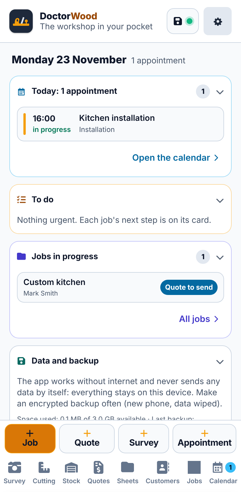
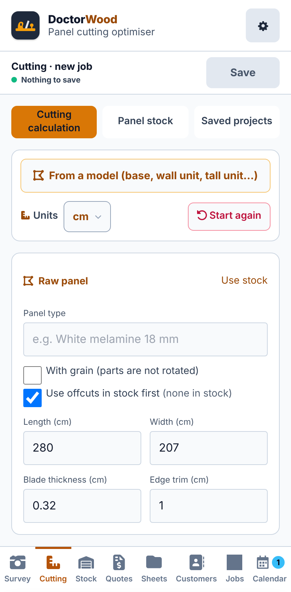
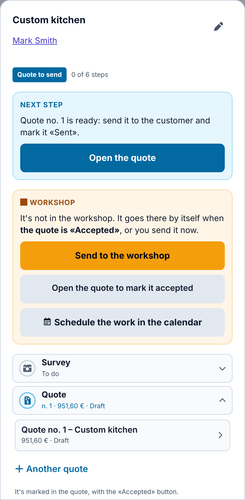
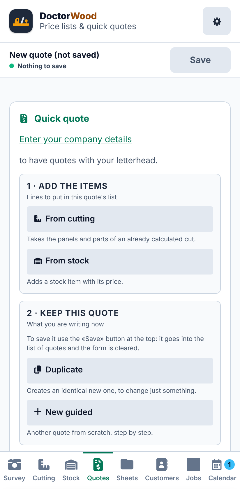
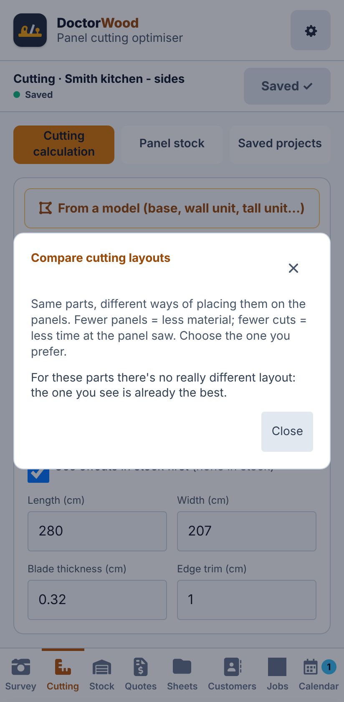
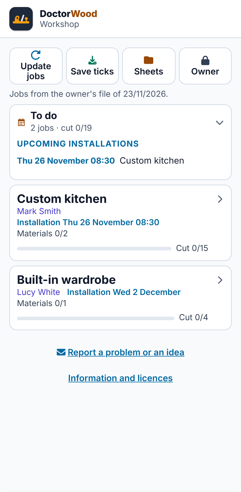

<p align="center">
  
</p>

<h1 align="center">DoctorWood</h1>
<p align="center"><b>Workshop management for carpenters and joiners, even without internet.</b></p>

<p align="center">Android 10+ · v1.1.1 · Also on PC · English and Italian · Free and open source (GPL-3.0)</p>

---

## Install

1. Open the **[Releases](../../releases/latest)** page of this repository on your phone or tablet.
2. Download the `DoctorWood-….apk` file and open it. The first time, Android asks you to allow installs from the browser or the Files app.
3. Done. Later versions arrive by themselves: DoctorWood checks once a week for a new one (can be turned off in Settings → Updates) and Android always asks for confirmation. This also works on the workshop tablet.

It installs over the previous version without losing data. It needs **Android 10 or later**.

## What it is

DoctorWood brings together a carpenter's everyday tools: from the **on‑site survey** to **panel cutting**, from the **quote** to the **installation**. It works **offline**: your data stays on your device, with no account and no cloud.

The same code comes in two forms: a single-file **web page** to open on a computer, and an **Android app** with camera, fingerprint and sync between the owner's phone and the workshop tablet.

<p align="center">
  
  &nbsp;
  
  &nbsp;
  
</p>

## Features

### Customers and jobs
- **Customers** with phone, email, address, VAT number or tax code.
- **Jobs**: everything about a commission in one place (survey, quote, cutting, materials, appointments, installation, payment, notes), with the **next step** always in view.
- **Guided paths** for a new job and a new quote.
- **Calendar** by week or month; **workshop days** are put in the calendar all at once from the job.

### On site
- **Surveys** with **photos** and dimensions drawn on them, taken with a dedicated camera (zoom, wide angle, HDR, grid, level), and a **survey PDF**.

### Design and sell
- **Panel cutting**: optimises the parts on the panels, can start **from a model** (base, wall unit, tall unit…), reuses offcuts and **compares up to four layouts** (panels, waste, cuts). Cutting list and **labels** in PDF (with barcode and **QR**), table for the panel saw, **DXF**.
- **Quotes** in PDF with items from cutting and from stock, **survey photos**, **customer signature** with a finger (valid only if the quote doesn't change afterwards) and **«For the invoice»** (a CSV for the accountant).
- **Stock**: price list, stock levels, «To reorder», mark‑ups.

<p align="center">
  
  &nbsp;
  
  &nbsp;
  
</p>

### The workshop tablet
- **Workshop mode**: full screen, large text, app pinned to the screen; only the jobs to make, the parts to cut, the materials and the assembly sheets. **No prices.**
- **«Workshop only» tablet**: chosen on first start, it stays in Workshop mode for good, with no PIN. Only the job title, customer name, installation address and date, parts and materials reach the tablet: never prices, phone numbers, emails or VAT numbers (an automated test checks this).
- **Ticks** for cut parts and taken materials, sent back to the owner; **«Read label»** with the QR.
- **Assembly sheets** with photos and PDFs.

### Owner's phone and tablet, always in step
- **Direct sync on the same Wi‑Fi** with PairWood: jobs go from the phone to the tablet with no internet and no server, over TLS 1.3.
- **QR pairing**; «Paired devices», «Forget», «Change code» for a lost tablet.
- Jobs are **signed by the owner**: the tablet discards anything not signed by that key.
- Alternatively, sync **through a folder** managed by another app (Syncthing, Drive…): encrypted files only.

### Security
- **Vault**: on a device used as Owner, switching to Workshop encrypts the data with a fingerprint‑protected key and, for emergencies, a password.
- **Fingerprint or PIN lock** on opening and when you return to the app; no content in recent apps.
- **Encrypted backups only** (AES‑256‑GCM, PBKDF2‑SHA‑256 with 600,000 rounds) with password strength checks.
- **«Erase everything from this device»** removes data, keys and permissions.

### Languages, appearance and help
**English and Italian** (Settings → Appearance → Language: the language changes at once; «Automatic» follows the phone; quotes and other PDFs come out in the chosen language). Theme automatic, light or dark (changes in one go, no flicker), animations, three text sizes, screen smoothness up to 120 Hz, adjustable vibration. **Report a problem or an idea** prepares an email to crslabs.info@gmail.com that you send yourself.

## Security and privacy
- The page **cannot connect to the internet**: CSP rule `connect-src 'none'`, only scripts with a sha256 hash, no external libraries.
- The network is used only by PairWood's native code (towards paired devices) and by the update check (one read from GitHub a week, can be turned off). None of your data leaves the device. Details in [`PRIVACY.md`](PRIVACY.md).
- Updates install only if the APK has the same signature as the app and the same published SHA‑256 fingerprint.
- All incoming data (backup, sync, files) is cleaned field by field; all displayed data goes through `esc()`.

## Documentation
| What | Where |
|---|---|
| User guide with screenshots (PDF) | [`guida/DoctorWood-Guide-EN.pdf`](guida/DoctorWood-Guide-EN.pdf) · Italian: [`guida/DoctorWood-Guida.pdf`](guida/DoctorWood-Guida.pdf) |
| «How to» tutorials (PDF) | [`guida/DoctorWood-Tutorials-EN.pdf`](guida/DoctorWood-Tutorials-EN.pdf) · Italian: [`guida/DoctorWood-Tutorial.pdf`](guida/DoctorWood-Tutorial.pdf) |
| Automated tests | [`prove/README.md`](prove/README.md) |
| Developer notes | [`DEVELOPMENT.md`](DEVELOPMENT.md) |
| Privacy policy | [`PRIVACY.md`](PRIVACY.md) |

## Project layout
```
sorgente-DoctorWood.html  the page (HTML, style and script in one file)
piattaforma-android.js    the Android layer (vault, files, vibration, sync, updates)
prepara.py                CSP hashes and www/index.html for the app
android/                  Android project (Capacitor 8) + PairWood SDK in android/pairwood-sdk
icona/, genera-icone.js   symbol, icons and splash screen
prove/                    automated tests (Playwright)
lingua/                   English translation (lingua/inglese.txt) and the script that puts it into the page
guida/                    user guide and tutorials in PDF, screenshots
rilasci/                  how to publish a version, and the file used by the updater
```
The code and its comments are in Italian; folder names too (`guida` = guide, `prove` = tests, `lingua` = language, `rilasci` = releases, `icona` = icon).

## Build
```
npm install
python3 prepara.py
npx cap sync android
cd android && ./gradlew assembleRelease
```
A signed APK needs the signing key, which is **not** in this repository: without it Gradle produces an unsigned APK for your own testing. Details in [`DEVELOPMENT.md`](DEVELOPMENT.md).

## Support DoctorWood

DoctorWood is free, with no ads and no data collection. If you find it useful you can buy me a coffee: **[ko-fi.com/crslabs](https://ko-fi.com/crslabs)**.

## Contact

Problems, ideas, questions: **crslabs.info@gmail.com** (English is fine), or «Report a problem or an idea» inside the app.

## Licence

© 2026 CrsLabs. DoctorWood is free software: you can use, study, modify and redistribute it under the terms of the **GNU General Public License version 3 or later** (full text in [`LICENSE`](LICENSE)). It is distributed in the hope that it will be useful, but **without any warranty**.

Third-party components: [Capacitor](https://capacitorjs.com) (MIT licence), Font Awesome Free icons (CC BY 4.0) partly redrawn, and the others listed in «Information and licences» inside the app. The PairWood sync engine belongs to CrsLabs and is included here precompiled in `android/pairwood-sdk`.
